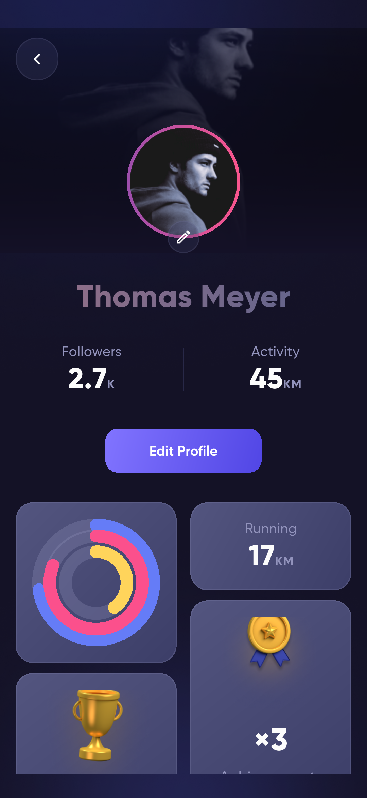

# Befit · Flutter Fitness App

根据 Pixso「Befit Dark / 📱Screens」参考实现的 Flutter 健身应用。沿用原稿的深蓝紫配色、Gilroy 字体、渐变按钮、运动卡片与头像素材。

包含可操作的首页、俱乐部、挑战、每日数据、引导注册、训练计时、运动记录和个人资料流程。

## 开始运行

```bash
flutter pub get
flutter run
```

首次进入完成引导与资料设置，之后直接进入首页。设置页可重放引导。

## 主要界面

下图均由 Android 模拟器中实际运行的 Flutter 应用生成。

| 首页 | 俱乐部 |
| --- | --- |
|  |  |

| 挑战 | 每日数据 |
| --- | --- |
|  |  |

| 训练计时 | 个人资料 |
| --- | --- |
|  |  |

## 项目资料

- [项目结构与架构说明](docs/项目说明.md)
- [完整界面截图索引](docs/界面截图.md)
- [测试与交付记录](docs/测试记录.md)
- [Pixso 设计来源与页面映射](docs/设计映射.md)

## 项目结构

```text
lib/
├── main.dart                    # 启动、系统栏和本地状态加载
├── app.dart                     # 应用入口、主题和路由
├── core/
│   ├── app_controller.dart      # 业务状态、写入队列、AppScope
│   ├── session_clock.dart       # 共用计时器
│   ├── theme.dart               # 设计色彩和主题
│   └── widgets.dart             # 渐变文字、按钮、卡片、头像等
├── data/
│   ├── local_store.dart         # 本地存储接口和实现
│   └── models.dart              # 运动模型与挑战目录
└── features/
    ├── home/                    # 首页、主导航、侧栏、收藏
    ├── club/                    # 俱乐部、动态、地图、通知
    ├── challenges/              # 任务与完成状态
    ├── daily/                   # 图表、饮水、体重和历史
    ├── activity/                # 户外运动与室内训练流程
    ├── profile/                 # 个人资料、编辑、设置
    └── onboarding/              # 五页引导与四步资料设置
```

采用 Flutter 自带的 `ChangeNotifier + InheritedNotifier` 管理共享状态，`shared_preferences` 保存本地数据。业务按功能拆分，公共视觉组件与计时逻辑集中复用。

## 检查和打包

```bash
flutter analyze
flutter test --concurrency=1
flutter drive --driver=test_driver/screenshots.dart --target=integration_test/app_test.dart -d emulator-5558
flutter build apk --release
flutter build web --release --output=build/web
```

模拟器标识需根据 `flutter devices` 的输出调整。界面测试会把截图输出到 `docs/screenshots/`。

## 当前交付边界

这是具备本地交互和持久化的 UI 应用。地图、运动距离/速度/海拔、社交动态、社区统计与图表基线采用演示数据；未连接真实 GPS、健康平台、云端账号、消息服务或系统推送。运动计时使用实际经过时间，记录保存于当前设备。

Android 可直接构建和安装。iOS 工程已准备，需在 macOS/Xcode 中完成真机编译与签名。
