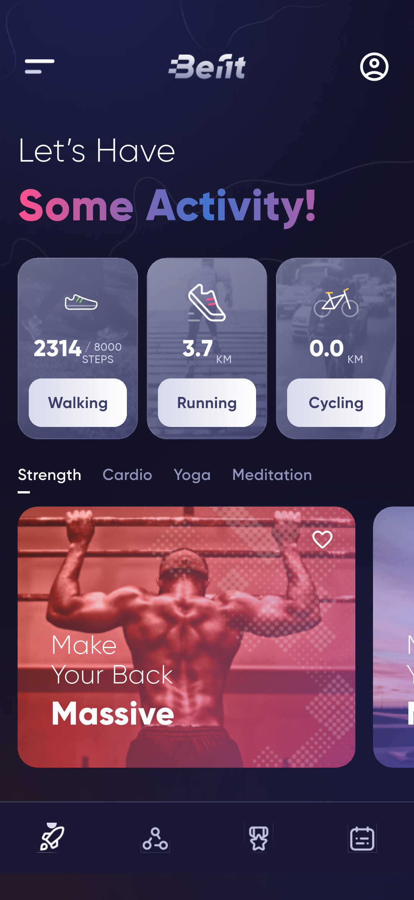
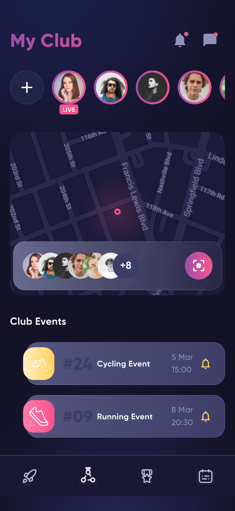
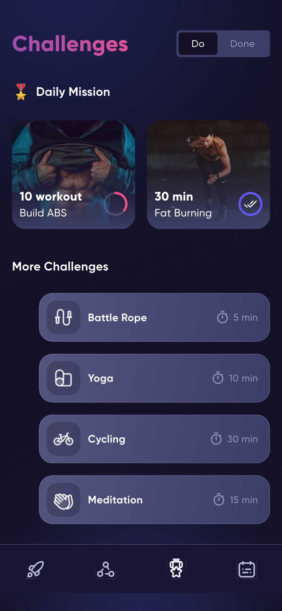
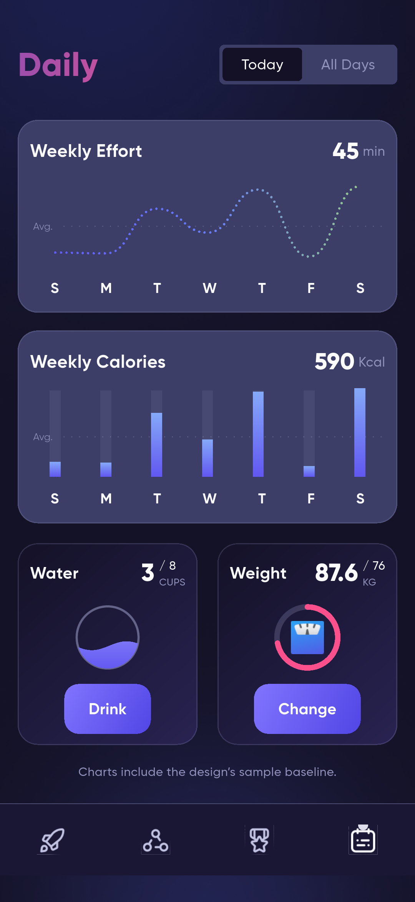
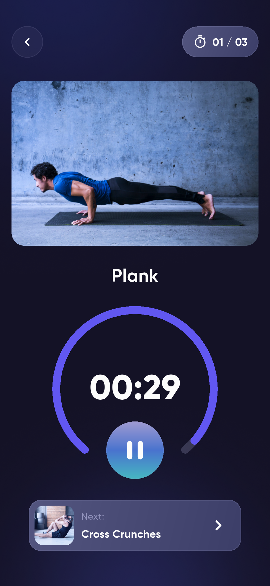
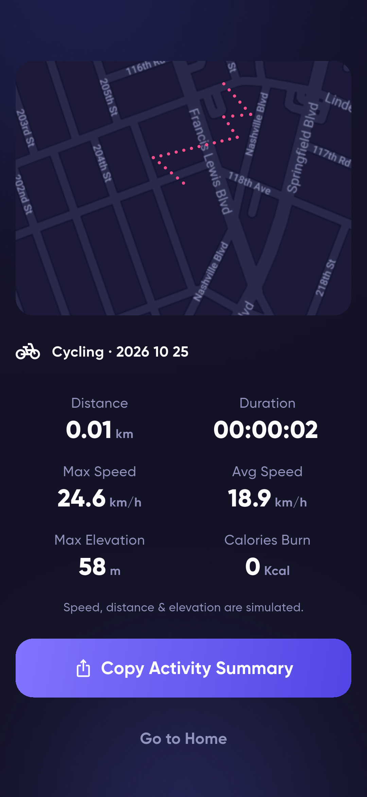

# Befit Flutter 项目结构与架构说明

## 1. 项目概述

Befit 是根据 Pixso「Befit Dark」设计稿实现的健身应用。本次交付以 Flutter 原生组件构建可操作界面，保留设计稿中的深色氛围、渐变标题、活动卡片、圆形训练计时器和地图视觉。

本项目位于 `befit_flutter/`。上一级的 `Befit App/` 是原有 React Native 参考项目，未修改。图片和字体从参考素材中选择复用，地图底图单独从 Pixso 导出；没有将整张页面截图作为应用界面。

## 2. 主要界面

以下是应用实际运行截图，原稿导出图另存于 `design/`。

### 首页与俱乐部

| 首页：活动入口与课程 | 俱乐部：动态与活动 |
| --- | --- |
|  |  |

首页可进入步行、跑步、骑行或室内训练，支持课程分类、横向浏览和收藏。俱乐部可打开动态、浏览地图成员，以及保存活动到本地通知列表。

### 挑战与每日数据

| 挑战清单 | 每日数据与健康习惯 |
| --- | --- |
|  |  |

挑战支持待完成/已完成筛选、进入训练和手动标记。每日页面提供周/月概览、饮水记录、体重编辑和已保存的运动历史。

### 训练与运动结果

| 训练倒计时 | 骑行结果 |
| --- | --- |
|  |  |

训练可以暂停、继续、进入下一动作并保存完成状态。运动可以开始、暂停、继续、结束确认，结束后保存记录并展示结果；摘要可复制到剪贴板。

所有界面和关键状态见[截图索引](界面截图.md)。

## 3. 技术方案

| 项目 | 方案 |
| --- | --- |
| 开发框架 | Flutter / Dart |
| UI | 原生 Widget、CustomPainter、项目内图片和字体 |
| 状态管理 | ChangeNotifier + InheritedNotifier |
| 路由 | MaterialApp + Navigator 命名路由 |
| 本地存储 | shared_preferences 的 SharedPreferencesAsync |
| 计时 | Stopwatch 测量经过时间，Timer 通知刷新 |
| 图表 | CustomPainter 绘制折线、柱状图、进度环和水球 |
| 地图 | Pixso 地图底图 + 路线绘制 + InteractiveViewer |
| 测试 | flutter_test、integration_test、Flutter Driver 截图接收器 |

运行时仅引入 `shared_preferences`（本地存储）和 `cupertino_icons`（跨平台系统图标资源），避免为简单界面引入额外的路由、图表或全局状态框架。测试依赖只参与开发。

设计主题在 `theme.dart` 集中维护：背景 `#141127`、面板 `#3C3E68`、次要文字 `#9293BC`、强调紫 `#6157F1`、强调粉 `#FB508C`。字体为本地 Gilroy，使用 300–800 六档字重。

## 4. 文件结构

```text
befit_flutter/
├── lib/
│   ├── main.dart
│   ├── app.dart
│   ├── core/
│   │   ├── app_controller.dart
│   │   ├── session_clock.dart
│   │   ├── theme.dart
│   │   └── widgets.dart
│   ├── data/
│   │   ├── local_store.dart
│   │   └── models.dart
│   └── features/
│       ├── home/home_screen.dart
│       ├── club/
│       │   ├── club_screen.dart
│       │   ├── map_screen.dart
│       │   └── story_screen.dart
│       ├── activity/
│       │   ├── activity_screen.dart
│       │   └── workout_screen.dart
│       ├── challenges/challenges_screen.dart
│       ├── daily/daily_screen.dart
│       ├── profile/profile_screen.dart
│       └── onboarding/onboarding_screen.dart
├── assets/                      # 参考素材；pubspec 仅声明使用到的资源
├── android/                     # Android 平台工程
├── ios/                         # iOS 平台工程
├── web/                         # Web 平台入口
├── test/
│   ├── app_controller_test.dart
│   └── widget_test.dart
├── integration_test/app_test.dart
├── test_driver/screenshots.dart
├── docs/
│   ├── 项目说明.md
│   ├── 界面截图.md
│   ├── 测试记录.md
│   ├── 设计映射.md
│   ├── design/                  # Pixso 原始参考导出
│   └── screenshots/             # 应用实际运行截图
├── pubspec.yaml
└── README.md
```

## 5. 架构与数据流

```text
界面 features/*
    │  调用业务方法 / 观察状态
    ▼
AppScope → AppController (ChangeNotifier)
    │  序列化状态、排队写入
    ▼
LocalStore 接口
    ├── PreferencesStore → SharedPreferencesAsync → 平台本地存储
    └── MemoryStore → 测试中的独立状态
```

- **界面层**：负责布局、导航和局部交互状态，例如当前分类、当前引导页、动态页码和地图选中成员。
- **业务状态层**：`AppController` 管理资料、饮水、体重、收藏、挑战、事件提醒和运动历史。状态改变后通知依赖它的界面。
- **数据层**：`LocalStore` 隔离平台读写，业务层不直接操作插件。测试使用内存实现，模拟器另有真实插件读写测试。
- **计时服务**：`SessionClock` 由训练或运动页面创建并释放。`Stopwatch` 避免依赖刷新次数累计时间，暂停会停止计时。
- **公共 UI**：背景、按钮、卡片、头像、分段选择、标题和环形进度集中在 `core/`。

这是面向当前 UI 与本地功能规模的轻量分层。后续接入服务时，可逐步将运动和社区数据替换为独立仓储，无需重写展示组件。

## 6. 页面与路由

| 路由 | 内容 | 主要入口 |
| --- | --- | --- |
| `/` | 主导航：Home / Club / Challenges / Daily | 完成注册、结果页回首页 |
| `/onboarding` | 5 页引导 | 首次启动、设置页 |
| `/register` | 姓名、生日、身高、体重 | 引导结束 |
| `/menu` | 用户侧栏 | 首页左上角 |
| `/favorites` | 收藏训练及空状态 | 侧栏 |
| `/profile` | 我的资料与统计 | 首页右上角、侧栏 |
| `/member` | 社区成员资料 | 地图成员卡片 |
| `/edit-profile` | 资料表单 | 个人资料、设置 |
| `/settings` | 本地偏好、引导重放、关于 | 侧栏 |
| `/notifications` | 本地活动提醒 | 俱乐部右上角 |
| `/stories` | 4 张动态、切换和本地点赞 | 俱乐部头像 |
| `/map` | 可缩放地图与成员卡片 | 俱乐部地图 |
| `/activity` | 步行/跑步/骑行会话 | 首页活动、俱乐部事件 |
| `/workout` | 室内训练计时与完成状态 | 首页课程、挑战 |
| `/congratulations` | 运动完成反馈 | 保存会话后 |
| `/result` | 最近一次运动结果 | 完成反馈页 |

四个主页面通过 `IndexedStack` 保留筛选和滚动状态；详情页面使用路由栈。运动会话中返回会先提示结束确认，防止误触丢失记录。

## 7. 核心交互流程

```text
首次启动 → 五页引导 → 姓名 → 生日 → 身高 → 体重 → 首页
首页 → 运动选择 → 开始 → 暂停/继续 → 结束确认 → 保存 → 完成反馈 → 结果
首页/挑战 → 训练 → 倒计时/暂停 → 下一动作 → 完成 → 更新挑战状态
俱乐部 → 地图 → 选择成员 → 成员资料 → 动态
每日 → 饮水或修改体重 → 保存 → 重启后恢复
```

姓名不能为空，资料编辑限制身高 100–230 cm、体重 30–200 kg。生日通过日期选择器选择。饮水最多记录 8 杯；本地日期变化后，在加载数据或下一次记录饮水时重置。

运动的计时是真实经过时间，距离按活动类型的演示速度估算。暂停不累计时间。训练每个动作结束时停止倒计时，也支持手动进入下一动作；动作图片是静态示意图，不是教学视频。

## 8. 本地存储

存储键：`befit.state.v1`，格式为 JSON。包括：

- 资料：姓名、生日、身高、体重、是否完成引导。
- 习惯：饮水杯数、对应本地日期。
- 偏好：提醒开关、单位选择、收藏课程 ID。
- 进度：已完成挑战 ID、保存的俱乐部事件 ID。
- 历史：活动类型、经过秒数、估算距离、保存日期。

写入通过 Future 队列顺序执行，避免连续点击造成旧状态覆盖新状态。读取失败时提供可用的默认界面；写入失败会显示提示，当前会话中的操作仍可使用。SharedPreferences 适合当前少量偏好与演示记录，未来大量运动轨迹应迁移至数据库。

## 9. 已实现与演示边界

| 功能 | 当前状态 |
| --- | --- |
| 引导、资料表单、校验 | 已实现 |
| 导航、分类、收藏 | 已实现并本地保存 |
| 训练倒计时、暂停、动作切换 | 已实现 |
| 运动开始、暂停、继续、保存 | 已实现 |
| 饮水、体重、挑战状态 | 已实现并本地保存 |
| 摘要导出 | 复制到系统剪贴板 |
| 地图缩放、成员选择 | 已实现；地图及路线为静态演示 |
| 速度、距离、海拔、热量 | 演示估算，无真实传感器数据 |
| 周/月图表 | 设计稿演示基线；总量叠加保存的运动记录 |
| 好友、动态、粉丝、奖章 | 设计样例内容；点赞/关注仅影响本次预览 |
| 事件提醒 | 本地收藏和通知列表，未调度系统通知 |
| Apple Health、手表 | 入口预览，未接入平台服务 |
| 登录、云同步、聊天、上传 | 未接入后端服务 |

## 10. 运行、验证与扩展

在项目根目录执行：

```bash
flutter pub get
flutter run -d emulator-5558
flutter analyze
flutter test --concurrency=1
flutter drive --driver=test_driver/screenshots.dart --target=integration_test/app_test.dart -d emulator-5558
flutter build apk --release
flutter build web --release --output=build/web
```

设备 ID 以 `flutter devices` 输出为准。iOS 编译需 macOS 和 Xcode。Android 当前使用开发签名，正式上架前应配置独立发布签名和应用标识。

后续扩展可按以下顺序进行：真实身份与社区接口、GPS 路线仓储、数据库历史记录、健康数据与可穿戴设备、系统提醒及分享接口。本次交付不要求这些服务的密钥即可运行。

参考 Flutter 官方的[架构建议](https://docs.flutter.dev/app-architecture/recommendations)、[集成测试说明](https://docs.flutter.dev/testing/integration-tests)及 [shared_preferences 文档](https://pub.dev/packages/shared_preferences)。
